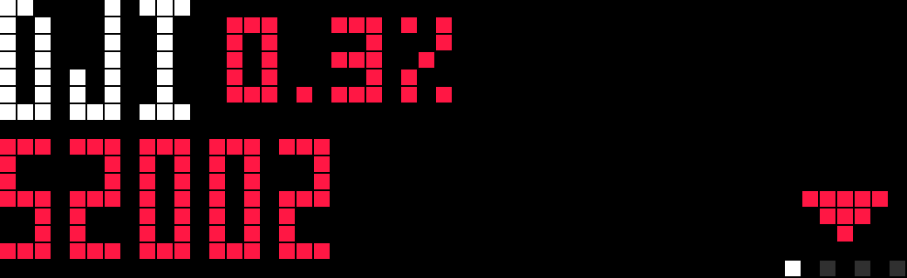
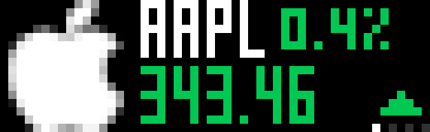
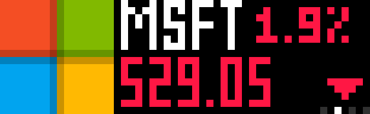
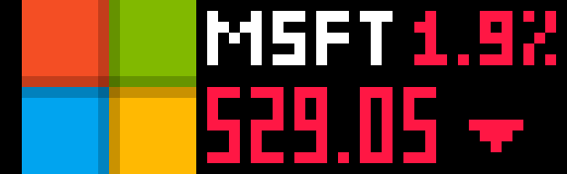
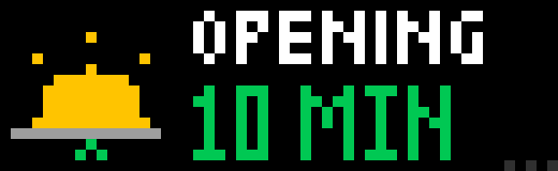
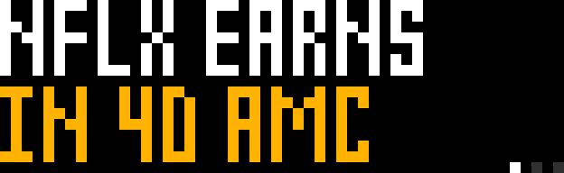

# US Stock Ticker for AWTRIX NG

Published on the AWTRIX Hub: https://awtrix.de/script/wO9XGWZKxKTx (install from there with one click).

| Ticker mode | Pages mode |
|---|---|
|  |  |

Berry app for the Ulanzi TC002 running AWTRIX NG. Shows up to twenty stock quotes, each
as one frame: the company logo on the left, the ticker in the large font with the day
change (one decimal, no sign, coloured) in the small font beside it, the price in the large font underneath coloured
green or red by direction, and a small up or down triangle in the lower-right corner so
the direction reads without colour. Two styles:

- **ticker** (default): the two-row blocks scroll across the panel as a line and each block
  stops for "Pause per stock" seconds once it is fully on the panel, so every detail can
  be read. 0 seconds scrolls without stopping.
- **pages**: one stock at a time, with a dot per stock along the bottom.

  

Quotes come from Yahoo Finance's public chart endpoint. Logos are the transparent
set in github.com/nvstly/icons (raw.githubusercontent.com); a ticker missing there
(BRK-B, SPY, QQQ...) falls back to financialmodelingprep.com's image-stock. Both are
keyless. Which source answers is probed once per symbol with a 16-byte GET (the clock's
HTTP client gets no answer to HEAD) and remembered on the clock, so later starts make no
probe; the image itself is downloaded once by the clock and cached. One quote request per
symbol per refresh, fetched one at a time.

## Security notes

- Symbols are the only user input that reaches a URL. They are reduced to letters, digits,
  `.`, `-` and `^` (encoded as `%5E`), at most 12 characters, uppercased; anything else in
  the field is ignored.
- All requests are HTTPS; the TC002 verifies certificates and hostnames.
- Responses are read through bounded windows (900 bytes for a quote, 320 for an earnings
  date, 16 for a logo probe) and parsed with regular expressions and `num()`; nothing from
  a response is executed, stored raw, or used to build a further URL.
- Values restored from the clock's store are type-checked before use.
- No API keys exist in the script, so there is nothing to leak from
  `GET /api/v1/apps/script/Stocks`.

 

## Install

```sh
curl -sX PUT "http://<clock-host>/api/v1/apps/script/Stocks" \
  -H 'Content-Type: text/plain' --data-binary @Stocks.ax
```

The reply must say `"error":null`. Replace the host with your clock's hostname or IP.
Remove with `curl -X DELETE http://<clock-host>/api/v1/apps/Stocks`.

## Settings

Web UI → Apps → gear on the Stocks row.

| Setting | Default | Notes |
|---|---|---|
| Stocks | AAPL,MSFT,GOOG | Comma-separated Yahoo symbols, up to twenty, 12 characters each of letters, digits, `.`, `-` or `^`. Empty: the Dow, S&P 500 and Nasdaq Composite (`DJI`, `US500`, `IXIC`), without logos or earnings. Class shares use a dash (`BRK-B`); an index is written with its caret (`^GSPC`). A symbol Yahoo does not know shows `NO SUCH TICKER` under its name. |
| Display | ticker | `ticker` or `pages`. |
| Company logo | on | Both modes. Off hides the logo and gives the text the full width. Parqet was dropped: it bakes a white square behind most logos. |
| Refresh | 5 min | Interval between fetch rounds. |
| Seconds per stock | 3 s | Pages: the app holds the panel for stocks × seconds. |
| Ticker speed | 200 % | Ticker: percent of the device scroll speed (100 = 21 px/s). |
| Space between stocks | 24 px | Ticker: gap after each stock's percentage. |
| Pause per stock | 2 s | Ticker: each block (and the banner) stops this long once fully on the panel; 0 = no stops. |
| Big move effect | off | Fireworks or rain behind a stock past the alert percentage. |
| Big move alert | 3 % | Threshold for the effect. |
| Up / Down colour | green / red | Chevron colour. No chevron when flat or unknown. |

## Knob

Turn the knob while the app is on screen to step back and forth between stocks, in both
modes; in ticker mode the line jumps so the neighbour block sits on the panel and holds
for the pause time (3 seconds if the pause is 0). Press the knob to switch the change
between percent and amount; the choice is remembered.

The fonts are proportional (MSFT is 17 px of ink, AAPL 15), and the firmware always
fits a web logo to a 16 px square, so the change carries no sign: `1.9%` in red says the
same as `-1.9%` and always fits beside a five-letter ticker. The decimal goes only when a
whole-number percentage would not fit (amounts: two decimals, one, none). The triangle
after the price (ticker) or in the corner (pages) is the colour-blind cue.


## Market banner

The first page (and the first block of the ticker) shows the market state with a glyph
drawn on the clock, readable from across the room: a blue moon for `MARKETS CLOSED`, a
sunrise with a green chevron for `OPENING 12 MIN`, a sunset with a red chevron for
`CLOSING 5 MIN`, and a sun for `UPDATED 9:14 PM` while the market is open.

Session times come from the first stock's quote (`currentTradingPeriod.regular` plus the
exchange's UTC offset), so DST is handled by Yahoo. The next open after a close is 9:30
exchange time on the next weekday; a holiday that Yahoo has not yet published as the next
session shows a countdown that morning. The first stock decides, so keep one exchange per list.

   

## Big-move effect (off by default)

With "Big move effect" on, a stock whose day change passes "Big move alert" percent gets
fireworks behind its frame on the way up or rain over it on the way down, in both modes,
and its page holds "Pause per stock" seconds longer. Nothing else changes: no card, no
transition.

## Fetching

Quotes refresh every "Refresh"
minutes while the market is open, once more after the close, and then not again until the
next session, so nothing is fetched overnight or at weekends.

## Earnings countdown

Each stock's next earnings date comes from Nasdaq (`api.nasdaq.com/api/analyst/<SYM>/earnings-date`,
keyless), fetched once per exchange day. Within three days the stock gets an earnings page
after its price page, `AAPL EARNS` / `IN 2D AMC`, and the ticker segment gains `EARN IN 2D AMC`.
`BMO` is before market open, `AMC` after market close; no suffix when Nasdaq gives no time.



## Behaviour

- Last good quotes are stored on the clock, so numbers show immediately after a reboot.
- A fetch failure keeps the last value. An unknown symbol shows `--`.
- A missing logo just shifts the text left; nothing else changes.
- Outside market hours the price is the last close and the change is that session's move.

## Verify after a change

```sh
curl -sX PUT http://<clock-host>/api/v1/apps/active -H 'Content-Type: application/json' -d '{"name":"Stocks","fast":true}'
curl -s http://<clock-host>/api/v1/display/screen   # 52x16 pixel array
```

Reference: AWTRIX NG Berry skill, `https://blueforcer.github.io/awtrix-ng/tc002/guides/ai-prompt/`.
